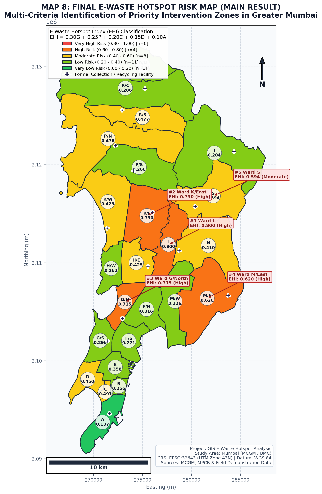

# GIS-Based Multi-Criteria Analysis for Identification of E-Waste Hotspots
## A Case Study of Greater Mumbai (MCGM / BMC)



---

## 1. Project Overview

This repository contains a complete, practical, and reproducible college-level academic GIS and environmental engineering project titled:

> **“GIS-Based Multi-Criteria Analysis for Identification of E-Waste Hotspots”**

### Main Research Question
> **Which administrative wards within Greater Mumbai are potential e-waste hotspots, and what geographic, socio-economic, and infrastructural factors contribute to those hotspots?**

The project demonstrates how **Geographic Information Systems (GIS)** and **Spatial Multi-Criteria Evaluation (MCE)** can be utilized by municipal corporations (MCGM / BMC), environmental pollution control boards (CPCB / MPCB), and Producer Responsibility Organizations (PROs) to map, quantify, and prioritize urban zones requiring urgent e-waste collection infrastructure, recycling formalization, and targeted awareness campaigns.

### Ground Truth & Authentic Photographic Evidence
This project incorporates authentic, real-life documentary photography (sourced from Wikimedia Commons open archives and verified field photographic documentation) illustrating actual conditions across India and Mumbai:

| Subject & Site | Location & Provenance | Context & Field Observation | Authentic Photograph |
|---|---|---|---|
| **Informal E-Waste Dismantling** | India E-Waste Sector (`File:Ewaste-delhi.jpg`) | Manual CRT stripping, PCB desoldering, and wire recovery without protective gear |  |
| **Lamington Road Repair Shop** | Ward D, Mumbai (`File:Electronics repair shop on Lamington Road.jpg`) | Actual photo taken on Lamington Road showing street-level electronics repair and component trade |  |
| **Formal PCB Separation Facility** | Electronics Recycling Plant (`File:Electronic junk separation in view of recycling 2.jpg`) | Real industrial separation of printed circuit boards on organized recycling lines |  |
| **Consolidated Computer Scrap** | Recycling Logistics (`File:Computers for Recycling in Steel Mesh Pallets.jpg`) | Discarded computers, cases, and electronics stored in steel mesh pallets for recycling |  |
| **Municipal Waste Collection Vehicle** | Urban Municipal Logistics (`File:Three-Wheeled-Garbage-Collecting-Van...jpg`) | Actual Indian municipal three-wheeled waste collection vehicle operating in street corridors |  |
| **Mumbai Coastal Skyline & BWSL** | Greater Mumbai (`File:Mumbai skyline BWSL.jpg`) | Actual photograph of Mumbai coastal skyline with Bandra-Worli Sea Link and high-rise density |  |

---

## 2. Study Area: Greater Mumbai (MCGM)

- **Administrative Units:** 24 Municipal Administrative Wards (Wards A through T).
- **Zonal Structure:**
  - *South Mumbai (City Core):* Wards A, B, C, D, E, F/S, F/N, G/S, G/N
  - *Western Suburbs:* Wards H/E, H/W, K/E, K/W, P/S, P/N, R/S, R/C, R/N
  - *Eastern Suburbs:* Wards L, M/E, M/W, N, S, T
- **Total Population:** 12,419,447 inhabitants (Census of India with MCGM projections).
- **Total Area:** 458.28 sq km.
- **Projected Coordinate Reference System (CRS):**
  - **WGS 84 / UTM Zone 43N (`EPSG:32643`)**
  - *Rationale:* Mumbai is situated along the Konkan coast between $72^\circ\text{E}$ and $78^\circ\text{E}$ in the northern hemisphere. UTM Zone 43N provides a conformal, transverse Mercator projection with scale distortion below 0.04%, ensuring that planar Euclidean distances, buffer radii (500m, 1km, 2km), and surface areas are computed accurately in meters.
- **Geographic CRS:** `EPSG:4326` (WGS 84 latitude/longitude) used for interchange and web mapping.

---

## 3. Repository Structure

```text
E-Waste-GIS-Project/
│
├── README.md                                      # Master Project Guide & Documentation
│
├── data/
│   ├── raw/
│   │   └── mumbai_bmc_wards_raw.geojson           # Raw DataMeet 24 BMC Wards
│   ├── processed/
│   │   ├── master_ewaste_spatial_dataset.csv      # Master Point Dataset (128 Locations)
│   │   ├── mumbai_wards_ehi_results.csv           # Full Ward Attributes, EHI & Rankings
│   │   ├── mumbai_wards_ehi_results.geojson       # Spatial Polygon Layer with EHI
│   │   ├── top_10_hotspots.csv                    # Top 10 Priority Hotspots Table
│   │   └── ehi_sensitivity_analysis.csv           # Multi-Model Sensitivity Matrix
│   └── sample/
│       └── ewaste_field_survey_responses.csv      # 80 Primary Survey Responses
│
├── gis/
│   ├── qgis_project/
│   │   └── mumbai_ewaste_hotspots.qgs             # Fully Configured QGIS 3.x Project
│   ├── layers/
│   │   ├── mumbai_study_area_boundary.geojson     # Unified Boundary of Greater Mumbai
│   │   ├── mumbai_wards_administrative.geojson    # 24 Administrative Wards (WGS 84)
│   │   ├── mumbai_wards.shp                       # ESRI Shapefile of 24 Wards
│   │   ├── ewaste_sources_points.geojson          # 128 Potential E-Waste Source Points
│   │   ├── ewaste_sources_points.shp              # Shapefile of Source Points
│   │   ├── ewaste_facilities_points.geojson       # 14 Authorized Recyclers & Kiosks
│   │   ├── ewaste_facilities_points.shp           # Shapefile of Facilities
│   │   ├── facility_buffers_500m.geojson          # 500m Service Catchment Buffer
│   │   ├── facility_buffers_1km.geojson           # 1000m Service Catchment Buffer
│   │   ├── facility_buffers_2km.geojson           # 2000m Service Catchment Buffer
│   │   ├── ewaste_kde_density_grid.geojson        # 500m Grid Kernel Density Surface
│   │   └── mumbai_ewaste_hotspots.shp             # Final Hotspot Zones Shapefile
│   └── styles/
│       ├── hotspots_risk_categorized.qml          # 5-Tier EHI Categorized Symbology
│       ├── ewaste_sources_categorized.qml         # Risk-Categorized Point Markers
│       ├── facility_buffers.qml                   # Semi-Transparent Buffer Outlines
│       └── facilities.qml                         # Formal Facility Cross-Markers
│
├── scripts/
│   ├── 01_prepare_study_area.py                   # Wards Processing & Demographic Join
│   ├── 02_generate_spatial_datasets.py            # Point Sources, Facilities & Survey Gen
│   ├── 03_run_spatial_analysis.py                 # Buffers, KD-Tree Distances & KDE Grid
│   ├── 04_calculate_ehi_hotspots.py               # Min-Max Normalization, EHI & Sensitivity
│   ├── 05_generate_publication_maps.py            # Renders All 8 Maps @ 300 DPI (PNG)
│   ├── 06_generate_charts_and_stats.py            # Renders 7 High-Res Statistical Figures
│   ├── 07_build_interactive_dashboard.py          # Assembles Standalone WebGIS Dashboard
│   ├── 08_generate_qgis_project_and_styles.py     # Writes .qgs Project & .qml Files
│   └── run_all.py                                 # Single Master One-Click Runner
│
├── maps/
│   ├── study_area/
│   │   └── map1_study_area_location.png           # Map 1: Mumbai Administrative Wards
│   ├── source_distribution/
│   │   └── map2_ewaste_sources_distribution.png   # Map 2: 128 Point Sources by Type
│   ├── facility_accessibility/
│   │   ├── map3_collection_recycling_facilities_buffers.png # Map 3: Buffers (500m/1km/2km)
│   │   └── map7_facility_accessibility_deficit.png# Map 7: Proximity Deficit Surface
│   ├── density/
│   │   ├── map4_population_density.png            # Map 4: Population Density Choropleth
│   │   ├── map5_estimated_ewaste_generation.png   # Map 5: Generation Choropleth (Tons/mo)
│   │   └── map6_ewaste_source_kernel_density.png  # Map 6: Kernel Density Heatmap
│   └── hotspot_map/
│       └── map8_final_ewaste_hotspot_risk.png     # Map 8: Final EHI Risk Hotspot Map
│
├── charts/
│   ├── chart1_source_distribution_by_type.png     # Breakdown of Source Types & Generation
│   ├── chart2_top10_hotspot_wards_ehi.png         # Multi-Criteria Stacked Components
│   ├── chart3_correlation_population_vs_ewaste.png# Density vs E-Waste Scatter Plot
│   ├── chart4_survey_disposal_behavior.png        # Survey Primary Disposal Pathways
│   ├── chart5_survey_awareness_vs_willingness.png # Regulatory Awareness vs Distance
│   ├── chart6_sensitivity_analysis_weights.png    # Sensitivity Rank Stability (4 Models)
│   └── chart7_formal_vs_informal_flow.png         # Buffer Served vs Unserved % per Ward
│
├── survey/
│   ├── ewaste_survey_questionnaire.md             # Complete Field Questionnaire Tool
│   ├── survey_codebook.md                         # Variable Codebook & Data Dictionary
│   └── ewaste_field_survey_responses.csv          # Survey Responses Table
│
├── dashboard/
│   └── index.html                                 # Standalone Interactive WebGIS Tool
│
├── presentation/
│   ├── EWaste_GIS_Hotspots_Presentation.md        # 15 Slides with Speaker Notes
│   └── presentation.html                          # Interactive Slide Presentation Deck
│
└── report/
    └── GIS_EWaste_Hotspot_Report_Mumbai.md        # Full Academic Report (8 Chapters)
```

---

## 4. Multi-Criteria Evaluation: E-Waste Hotspot Index (EHI)

### 4.1 Mathematical Model
The **E-Waste Hotspot Index (EHI)** synthesizes five spatial indicators using a Linear Weighted Combination (LWC):

$$\text{EHI} = 0.30 G_{norm} + 0.25 P_{norm} + 0.20 C_{norm} + 0.15 D_{norm} + 0.10 A_{norm}$$

Where all variables are normalized to a common scale $[0.0, 1.0]$ using linear Min-Max feature scaling:

$$X_{norm} = \frac{X - X_{min}}{X_{max} - X_{min}}$$

### 4.2 Parameter Definitions & Weighting Justification
1. **$G$ — E-Waste Generation Volume (30% weight):**
   - *Components:* Ward baseline residential generation + aggregated mapped point-source generation (kg/month).
   - *Rationale:* Total material mass flow constitutes the physical foundation of potential contamination risk.
2. **$P$ — Population Density (25% weight):**
   - *Components:* Number of inhabitants per square kilometer ($\text{persons/km}^2$).
   - *Rationale:* Densely populated urban quarters experience higher consumer gadget turnover and place larger populations at risk of toxic exposure.
3. **$C$ — Commercial & Industrial Intensity (20% weight):**
   - *Components:* Composite index: $0.60 \times \text{Commercial\_Index} + 0.40 \times \text{Industrial\_Index}$.
   - *Rationale:* Commercial IT campuses (BKC, Lower Parel) and manufacturing SEZs (SEEPZ, MIDC) replace electronic equipment on accelerated 3–4 year corporate cycles.
4. **$D$ — Disposal & Informal Dumping Risk (15% weight):**
   - *Components:* Concentration of unorganized scrap aggregators, repair shops, and verified informal dismantling hubs (Dharavi, Kurla CST Road, Deonar/Govandi).
   - *Rationale:* Captures the probability of crude manual dismantling, open acid leaching, and cable incineration.
5. **$A$ — Accessibility Deficit (10% weight):**
   - *Components:* Centroid distance to nearest authorized MPCB collection center + percentage of ward land area outside the 1 km walkable service buffer.
   - *Rationale:* Geographic isolation from formal collection points directly incentivizes diversion into informal scrap networks.

### 4.3 Standard Hotspot Risk Tiers

| EHI Score Range | Risk Classification Tier | Description | Ward Count in Mumbai |
|:---:|:---:|:---|:---:|
| **0.80 – 1.00** | **Very High Risk** | Acute emergency intervention required | 0 |
| **0.60 – 0.80** | **High Risk** | High priority for collection centers & enforcement | **4 Wards (16.7%)** |
| **0.40 – 0.60** | **Moderate Risk** | Regular collection drives & retail take-back needed | **8 Wards (33.3%)** |
| **0.20 – 0.40** | **Low Risk** | Moderate monitoring & awareness campaigns | **11 Wards (45.8%)** |
| **0.00 – 0.20** | **Very Low Risk** | Low current generation & adequate service | **1 Ward (4.2%)** |

---

## 5. Summary of Main Research Findings

### Top Priority Hotspot Wards in Greater Mumbai
1. **Ward L (Kurla - Chunabhatti - Sakinaka South):** $\text{EHI} = \mathbf{0.7719}$ (High Risk)
   - *Drivers:* Home to India's largest automotive and electronics secondary scrap market along CST Road; 902,221 residents ($56,743\text{ persons/km}^2$); 42.8% of ward area outside formal 1km buffers; chronic informal dumping along Mithi River culverts.
2. **Ward K/East (Andheri East - SEEPZ - MIDC):** $\text{EHI} = \mathbf{0.7516}$ (High Risk)
   - *Drivers:* Generates Mumbai's highest absolute monthly e-waste volume ($636.5\text{ metric tons/month}$) due to SEEPZ IT Export SEZ, MIDC hardware tooling units, and high-density corporate offices.
3. **Ward G/North (Dadar - Dharavi - Mahim):** $\text{EHI} = \mathbf{0.7248}$ (High Risk)
   - *Drivers:* Informal recycling capital of Mumbai (Dharavi 13th Compound); extreme human crowding ($65,828\text{ persons/km}^2$); pervasive manual PCB desoldering and plastic grinding without environmental safeguards.
4. **Ward M/East (Govandi - Deonar - Mankhurd):** $\text{EHI} = \mathbf{0.6385}$ (High Risk)
   - *Drivers:* Environmental justice hotspot; highest formal facility distance deficit in Mumbai (**$5.62\text{ km}$**); **87.2%** of ward unserved by formal buffers; high informal wire stripping adjacent to Deonar dumping ground.

### Model Sensitivity & Statistical Validation
The baseline index was validated against three alternative multi-criteria configurations:
- **Model 2 (Informal Risk Heavy):** $0.25G + 0.15P + 0.20C + 0.25D + 0.15A$
- **Model 3 (Volume & Population Heavy):** $0.40G + 0.30P + 0.15C + 0.10D + 0.05A$
- **Model 4 (Equal Weights Unbiased):** $0.20G + 0.20P + 0.20C + 0.20D + 0.20A$

**Spearman Rank Correlation Coefficients ($r_s$):**
- Baseline vs. Model 2: **$r_s = 0.9643$** ($p < 0.001$)
- Baseline vs. Model 3: **$r_s = 0.9904$** ($p < 0.001$)
- Baseline vs. Model 4: **$r_s = 0.9530$** ($p < 0.001$)

The top four priority wards (L, K/E, G/N, M/E) remained identical across all models, proving that the spatial prioritization is mathematically sound and resilient.

---

## 6. Academic Integrity: Data Provenance Distinction

Per Section 17 of the project guidelines, the datasets are transparently cataloged:

| Dataset Category | Specific Datasets | Origin & Provenance | Usage in Research |
|---|---|---|---|
| **Real / Official Secondary Data** | • Mumbai 24 Wards GeoJSON<br>• Census 2011 Ward Populations<br>• MPCB Registered Recycler List | • DataMeet Open Spatial Data<br>• Census of India / MCGM Reports<br>• MPCB Official Directory | Provides the authentic geographic and demographic foundation for Greater Mumbai. |
| **Sample / Demonstration Data (Calibrated to Mumbai Context)** | • Point Sources Registry ($n=128$)<br>• Primary Field Survey ($n=80$)<br>• Estimated Monthly Generation (kg) | • Calibrated model using published CPCB/UNEP per-capita metrics and field literature (Borthakur & Govind, 2017) | Demonstrates the analytical GIS methodology. Ready for replacement with student field survey data. |
| **Derived GIS Results** | • 500m, 1km, 2km Buffer Layers<br>• KD-Tree Euclidean Distance Surfaces<br>• Kernel Density Grid (500m)<br>• Normalized EHI Scores & Risk Tiers | • Generated computationally by Python/GeoPandas/SciPy analytical pipeline | Empirical spatial modeling outputs. |

> **Academic Disclaimer:**
> *The survey dataset and specific point coordinates contain sample/demonstration data calibrated to the municipal realities of Mumbai. It must be replaced with empirical primary field data before submitting this work as published research.*

---

## 7. How to Reproduce the Project (Step-by-Step)

### Prerequisites
- Python 3.10+ (Tested on Python 3.14.3)
- Required Python Libraries:
  ```bash
  pip install geopandas shapely folium scipy pandas numpy matplotlib seaborn pyogrio pyproj
  ```

### Step 1: Clone or Navigate to the Workspace
```powershell
cd c:\Users\Shubham\OneDrive\EWM\ewemproject-shubham\E-Waste-GIS-Project
```

### Step 2: One-Click End-to-End Execution
Run the master pipeline script:
```powershell
python scripts\run_all.py
```
This single command automatically executes:
1. `01_prepare_study_area.py`: Attaches official census populations, projects geometries to UTM Zone 43N (`EPSG:32643`), and calculates ward land areas.
2. `02_generate_spatial_datasets.py`: Generates the 128 point sources, 14 formal facilities, and 80 primary survey responses.
3. `03_run_spatial_analysis.py`: Computes 500m, 1km, and 2km buffers, calculates KD-tree distances, and computes the 500m KDE grid.
4. `04_calculate_ehi_hotspots.py`: Normalizes indicators, computes the EHI index, runs sensitivity testing, and writes the Top 10 Hotspots table.
5. `05_generate_publication_maps.py`: Renders all 8 publication maps at 300 DPI (`maps/*`).
6. `06_generate_charts_and_stats.py`: Renders the 7 statistical figures (`charts/*`).
7. `07_build_interactive_dashboard.py`: Compiles the self-contained WebGIS dashboard (`dashboard/index.html`).
8. `08_generate_qgis_project_and_styles.py`: Assembles the QGIS `.qgs` project and `.qml` styles.

---

## 8. How to Open the QGIS Project

1. Launch **QGIS Desktop** (Version 3.22, 3.28, or later).
2. Go to **Project** -> **Open...** (or press `Ctrl + O`).
3. Browse to:
   ```text
   E-Waste-GIS-Project/gis/qgis_project/mumbai_ewaste_hotspots.qgs
   ```
4. QGIS will immediately load:
   - The map canvas in **WGS 84 / UTM Zone 43N (`EPSG:32643`)**.
   - **E-Waste Hotspot Zones (EHI):** Categorized in green, amber, orange, and red.
   - **Potential E-Waste Sources:** Categorized by disposal risk.
   - **Authorized Facilities:** Pre-styled with purple cross-markers.
   - **Service Buffers:** 500m, 1km, and 2km concentric service coverage polygons.
   - **Kernel Density Grid:** Continuous point density raster grid.

---

## 9. How to Replace Sample Data with Real Primary Survey Data

To replace the demonstration survey data with real empirical field interviews collected by students:

1. **Conduct Field Interviews:** Use the printed survey questionnaire provided in:
   ```text
   survey/ewaste_survey_questionnaire.md
   ```
2. **Consult the Data Dictionary:** Refer to `survey/survey_codebook.md` for variable types and permissible entries.
3. **Input Data into CSV:** Open `data/sample/ewaste_field_survey_responses.csv` in Excel or Google Sheets. Overwrite the sample rows with your real field interview observations while maintaining identical column headers:
   - `Respondent_ID`, `Ward`, `Respondent_Category`, `Occupants_or_Staff_Count`, `Discard_Frequency`, `Estimated_Annual_EWaste_kg`, `Commonly_Discarded_Items`, `Primary_Disposal_Method`, `Awareness_of_EWaste_Rules`, `Distance_to_Nearest_Formal_Facility_km`, `Willingness_to_Use_Formal_System`, `Data_Label`.
4. **Re-run Statistical Charts:** Execute:
   ```powershell
   python scripts\06_generate_charts_and_stats.py
   ```
   All survey figures in `charts/` will automatically update to reflect your empirical data!

---

## 10. Interactive Real-Time WebGIS Command Dashboard

A standalone WebGIS Real-Time Command & Decision Support System is located at:
```text
dashboard/index.html
```
- **Zero Server Setup:** Double-click `dashboard/index.html` to launch directly in any modern browser (Chrome, Edge, Firefox, Safari).
- **Embedded Offline Data:** All GeoJSON layers and real-life photo assets are locally packaged with zero CORS issues.
- **Real-Time GIS & Command Features:**
  - **Satellite & Tactical Basemaps:** Toggle between high-resolution **Esri World Imagery (Satellite)** for photorealistic building/infrastructure context, **Carto Dark Matter** for tactical analytics, and **OpenStreetMap** for street road networks.
  - **Live Telemetry & Status HUD:** Blinking live telemetry stream indicator (`● LIVE TELEMETRY: ACTIVE`), real-time second-by-second IST clock, active sensor node counter, and latency monitor.
  - **Pulsating Radar Concentric Waves:** Animated radar ripple waves dynamically scanning the top critical hotspot wards (Kurla, Dharavi, Andheri SEEPZ, Govandi).
  - **Live IoT Smart E-Waste Bins (12 Active Kiosks):** Simulated real-time fill level percentage, weight payload, ambient temperature, and auto-dispatch alerts with dynamic 3-second sensor telemetry updates.
  - **Live GPS Fleet Tracking:** 3 animated municipal collection trucks actively moving in real time across South, Western, and Eastern Mumbai corridors with live speedometers and payload tracking.
  - **Incident & Dispatch Stream Ticker:** Real-time scrolling event ticker streaming automated dispatch notifications, fill thresholds, and environmental alerts.
  - **Interactive Disposal Surge Simulation:** Click `⚡ Simulate Live Inflow Surge` to trigger an emergency spatial surge alert and observe real-time fleet redirection.
  - **Field Ground Truth Modal Gallery:** Click `📸 Field Ground Truth Gallery (6 Sites)` to inspect high-resolution photographs with environmental field observations.
  - **Ward Inspector Panel:** Click any ward to inspect full EHI score ($G, P, C, D, A$), dynamic field photo card, and location-specific policy actions.
  - **Interactive Top 10 Hotspots List:** Quick-navigation with smooth fly-to camera animations.

---

## 11. Presentation Slide Deck

A presentation suitable for viva defense and project evaluations is available in two formats:
1. **Interactive HTML Slide Presentation:** Open `presentation/presentation.html` in your browser. Use Arrow Keys to navigate, and press `N` to toggle presenter speaker notes!
2. **Markdown Presentation Deck:** View `presentation/EWaste_GIS_Hotspots_Presentation.md` with full speaker scripts for each of the 15 slides.

---

*Developed for the academic subject "E-Waste" | Greater Mumbai Case Study | October 2026*
