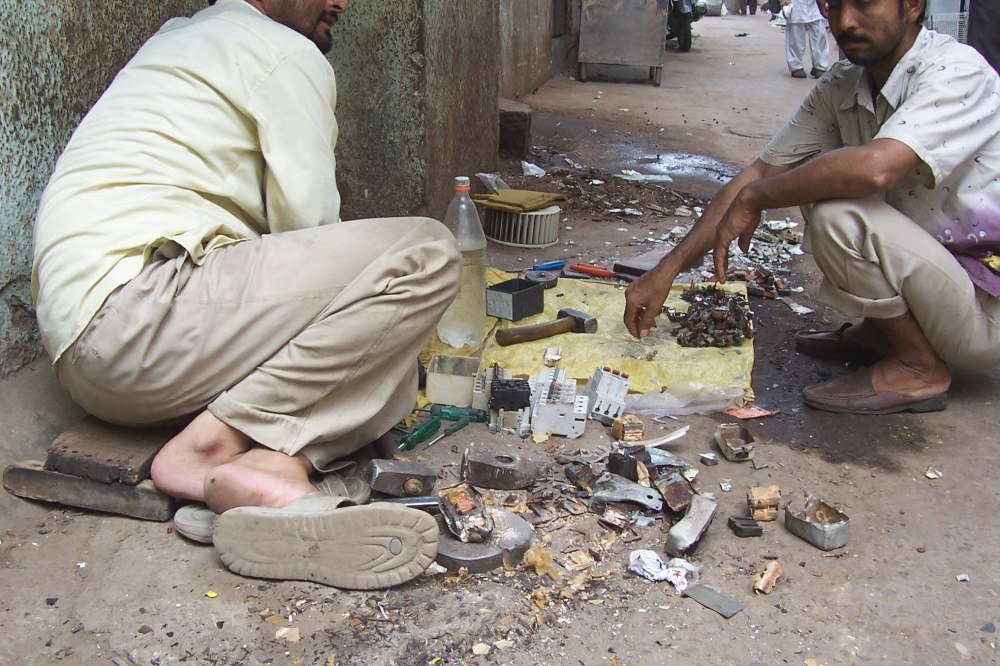
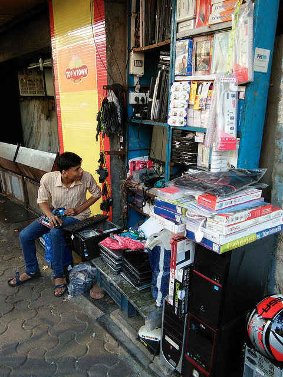
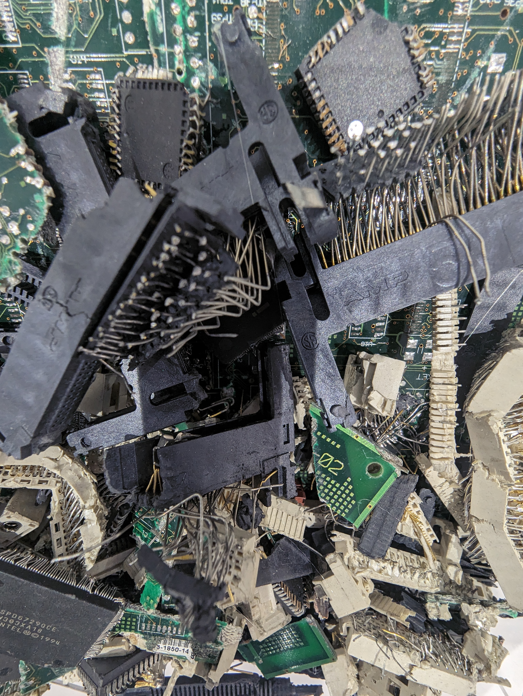
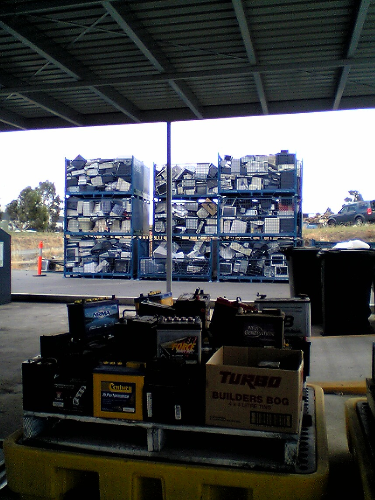
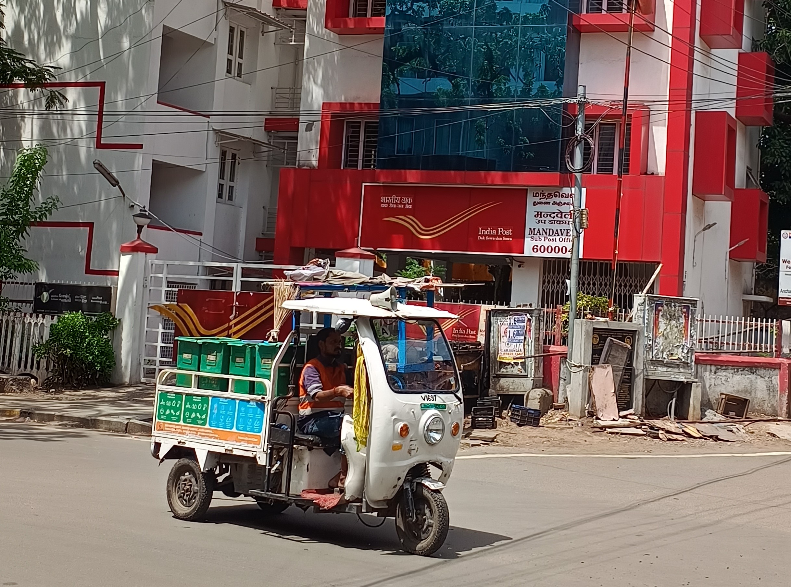

# GIS-Based Multi-Criteria Analysis for Identification of E-Waste Hotspots
### A Study of the Municipal Corporation of Greater Mumbai (MCGM / BMC)

[](https://github.com/shubhamsinnn)
[](https://github.com/shubhamsinnn/ewemproject-shubham)
[](https://www.python.org/)
[](https://qgis.org/)
[](https://leafletjs.com/)

---

## 🌟 Quick Interactive Deliverables

| Deliverable | Description | Quick Link |
|---|---|---|
| 🛰️ **Interactive WebGIS Dashboard** | Real-Time Command & Decision Support System with live radar sweeps, moving fleet tracking & satellite overlays | [`E-Waste-GIS-Project/dashboard/index.html`](./E-Waste-GIS-Project/dashboard/index.html) |
| 📊 **Interactive Slide Presentation** | 15-slide presentation on Mumbai E-Waste GIS research | [`E-Waste-GIS-Project/presentation/presentation.html`](./E-Waste-GIS-Project/presentation/presentation.html) |
| 📑 **Academic Project Report** | Complete 8-Chapter Comprehensive Research Monograph (Chapters 1–8) | [`E-Waste-GIS-Project/report/GIS_EWaste_Hotspot_Report_Mumbai.md`](./E-Waste-GIS-Project/report/GIS_EWaste_Hotspot_Report_Mumbai.md) |
| 🗺️ **Publication Maps (300 DPI)** | 8 publication-quality maps (Hotspots, Buffers, Sources, Risk Tiers) | [`E-Waste-GIS-Project/maps/`](./E-Waste-GIS-Project/maps/) |
| 🧭 **QGIS 3.x Project** | Ready-to-open GIS project with categorized layers and symbology | [`E-Waste-GIS-Project/gis/qgis_project/mumbai_ewaste_hotspots.qgs`](./E-Waste-GIS-Project/gis/qgis_project/mumbai_ewaste_hotspots.qgs) |
| 📋 **Field Survey & Dataset** | 80 primary stakeholder responses & 128 geocoded spatial sources | [`E-Waste-GIS-Project/survey/`](./E-Waste-GIS-Project/survey/) |

---

## 📸 Ground Truth & Authentic Field Photography

This project integrates real-life documentary photography and field evidence across key operational sectors in Mumbai:

| Sector & Focus | Location Context | Real Photograph |
|---|---|---|
| **Informal E-Waste Dismantling** | Dharavi & Kurla informal recycling clusters: manual stripping of CRTs & desoldering PCBs |  |
| **Electronics Retail & Repair** | Lamington Road (Ward D), South Mumbai: street-level hardware repair hubs |  |
| **Formal PCB Separation** | Industrial electronics recovery plant with automated shredding and segregation |  |
| **Consolidated Hardware Pallets** | Corporate IT e-waste staging and palletized reverse logistics |  |
| **Municipal Collection Logistics** | Door-to-door municipal collection vehicles in urban corridors |  |
| **Urban Fabric & Density** | Greater Mumbai peninsula, high-density residential and commercial towers |  |

---

## 📌 Executive Summary

Rapid urbanization, digital device obsolescence, and consumer lifestyle shifts have accelerated electronic waste generation across the **Municipal Corporation of Greater Mumbai (MCGM / BMC)**. This academic project provides an empirical, spatial-analytical framework to identify and prioritize e-waste hotspots across all **24 Municipal Wards (A through T)**.

### Research Questions Addressed:
1. **Spatial Concentration:** Where are obsolete electronic components being accumulated, traded, and dismantled within Greater Mumbai?
2. **Infrastructure Deficits:** How far are primary generation nodes from authorized MPCB recyclers and PRO collection kiosks?
3. **Action Prioritization:** Which wards demonstrate high cumulative environmental and disposal risk requiring immediate intervention?

---

## 🔬 Spatial Multi-Criteria Analysis (EHI Formulation)

The **E-Waste Hotspot Index (EHI)** integrates five standardized spatial and demographic criteria using Min-Max normalization ($[0, 1]$):

$$\text{EHI}_i = w_G \cdot G_i + w_P \cdot P_i + w_C \cdot C_i + w_D \cdot D_i + w_A \cdot A_i$$

Where:
- $G_i$ = Estimated Monthly E-Waste Generation Volume (weight: **0.30**)
- $P_i$ = Population Density per $\text{km}^2$ (weight: **0.20**)
- $C_i$ = Commercial & Industrial Land-Use Activity Index (weight: **0.20**)
- $D_i$ = Network Distance to Nearest Authorized Facility (weight: **0.15**)
- $A_i$ = Unserved Population Ratio outside 1 km collection buffers (weight: **0.15**)

### Top High-Risk Hotspot Wards Identified:
1. **Ward L (Kurla - CST Road):** Major informal automotive & electronics dismantling hub.
2. **Ward K/E (Andheri East - SEEPZ):** High generation from tech hardware manufacturing & SEZ export zones.
3. **Ward G/N (Dharavi - Mahim):** High-density manual scrap processing & informal recovery workshops.
4. **Ward M/E (Govandi - Deonar):** Informal scrap sorting near peripheral dumping grounds.
5. **Ward D (Lamington Road - Grant Road):** Highest commercial density of hardware wholesale and repair shops.

---

## 📁 Repository Directory Structure

```text
ewemproject-shubham/
├── index.html                                     # WebGIS Dashboard Root Launcher
├── README.md                                      # Project Homepage & Overview
│
└── E-Waste-GIS-Project/
    ├── README.md                                  # In-Depth Technical Manual
    ├── assets/images/                             # Real-life Field Photographs
    │
    ├── dashboard/                                 # Interactive Real-Time WebGIS Application
    │   ├── index.html                             # Full Single-Page Command Dashboard
    │   └── images/                                # Local Visual Assets
    │
    ├── presentation/                              # Academic Slides Deck
    │   ├── presentation.html                      # 15-Slide Responsive Web Presentation
    │   └── images/                                # Slide Graphics
    │
    ├── report/                                    # Full Academic Monograph
    │   └── GIS_EWaste_Hotspot_Report_Mumbai.md    # 8-Chapter Academic Report
    │
    ├── gis/                                       # GIS Project & Vector Layers
    │   ├── qgis_project/mumbai_ewaste_hotspots.qgs
    │   ├── layers/                                # GeoJSON & ESRI Shapefiles
    │   └── styles/                                # QGIS .qml Symbology Files
    │
    ├── maps/                                      # 8 Publication-Ready 300 DPI Maps
    ├── charts/                                    # 7 Statistical Analytical Figures
    ├── survey/                                    # Questionnaire & 80 Survey Records
    ├── data/                                      # Processed Spatial Datasets
    │
    └── scripts/                                   # Python GIS Processing Pipeline
        ├── 01_prepare_study_area.py
        ├── 02_generate_spatial_datasets.py
        ├── 03_run_spatial_analysis.py
        ├── 04_calculate_ehi_hotspots.py
        ├── 05_generate_publication_maps.py
        ├── 06_generate_charts_and_stats.py
        ├── 07_build_interactive_dashboard.py
        ├── 08_generate_qgis_project_and_styles.py
        └── run_all.py                             # One-Click Master Execution
```

---

## 🚀 Running the Project Locally

### 1. Launch the Real-Time Command Dashboard
Navigate to the project and start an HTTP server:
```powershell
cd c:\Users\Shubham\OneDrive\EWM\ewemproject-shubham\E-Waste-GIS-Project
python -m http.server 8080
```
Open **`http://localhost:8080/dashboard/`** in your browser.

### 2. Run the Full GIS Pipeline from Scratch
To recalculate all spatial buffers, regenerate statistical charts, and export publication maps:
```powershell
python scripts\run_all.py
```

---

## 👤 Author & Academic Credits

- **Project Lead & GIS Research:** **Shubham Singh** ([@shubhamsinnn](https://github.com/shubhamsinnn))
- **Study Area:** Municipal Corporation of Greater Mumbai (MCGM / BMC), Maharashtra, India
- **Repository:** [https://github.com/shubhamsinnn/ewemproject-shubham](https://github.com/shubhamsinnn/ewemproject-shubham)
